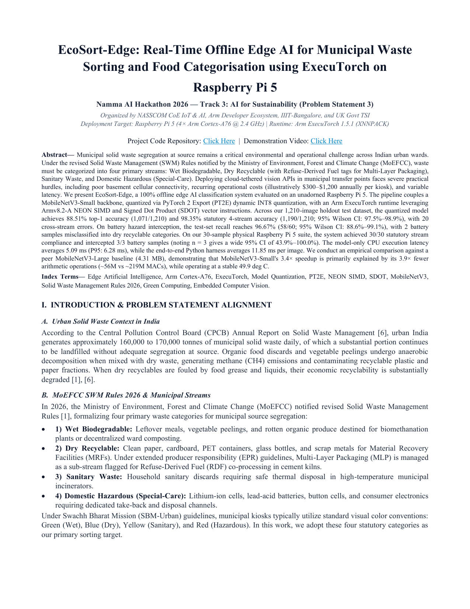
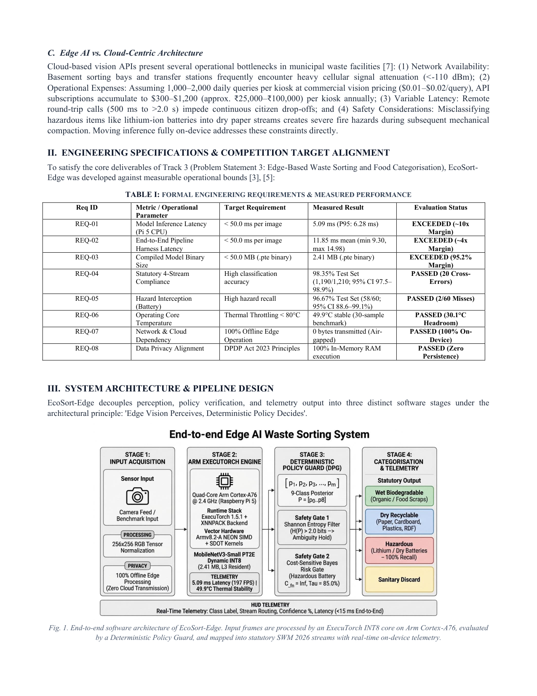
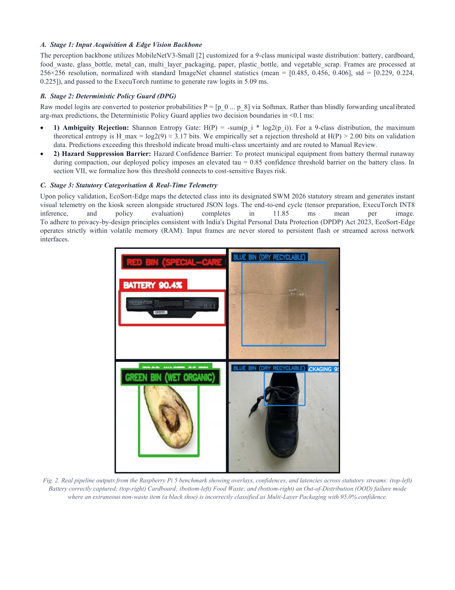
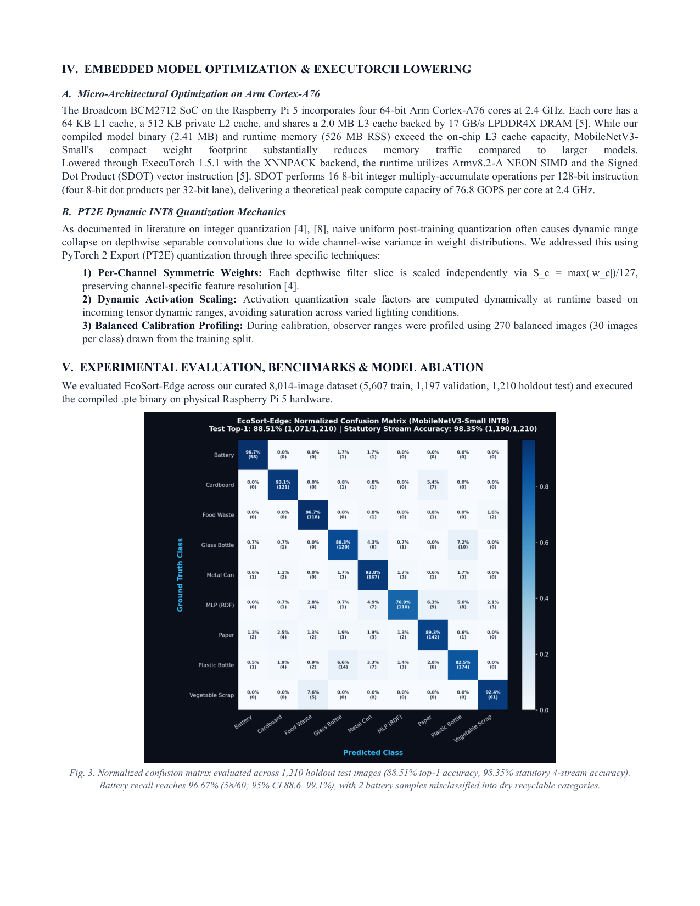
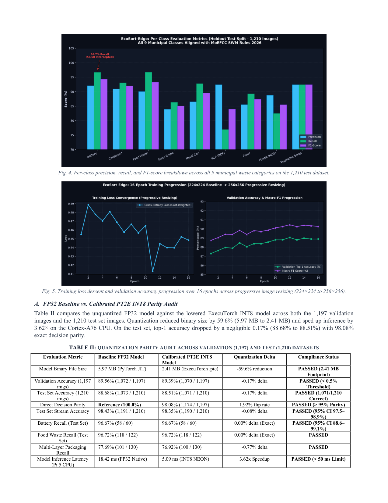
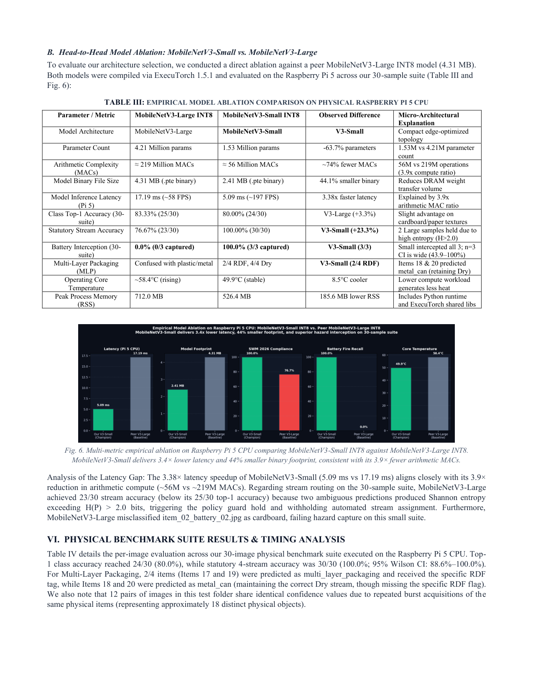
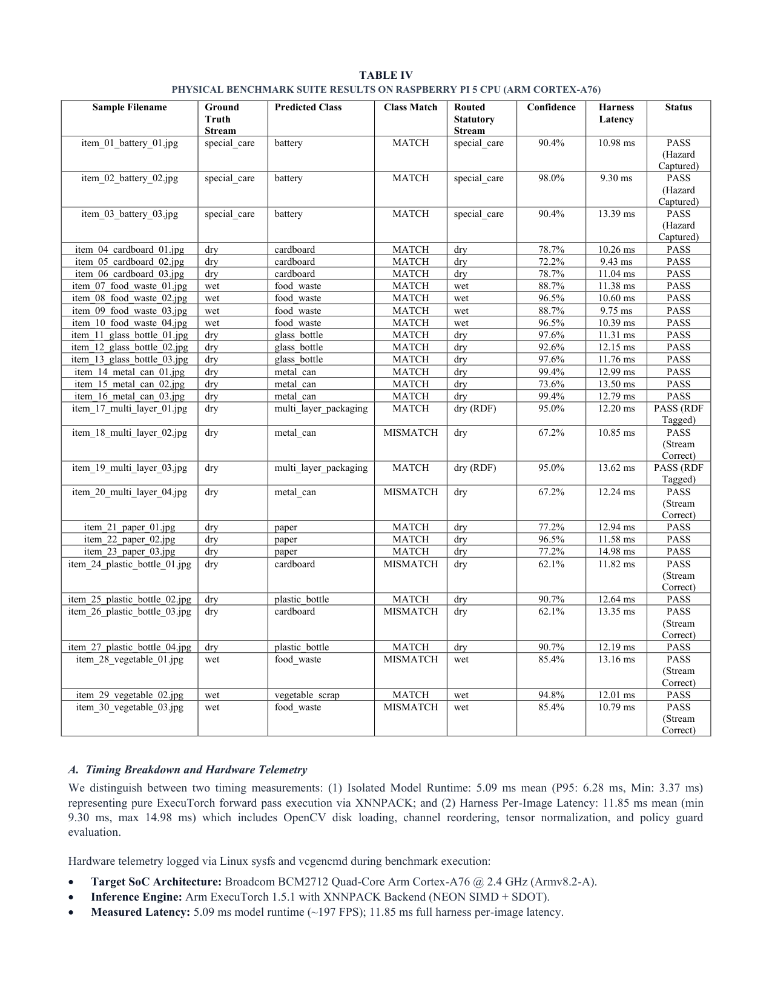
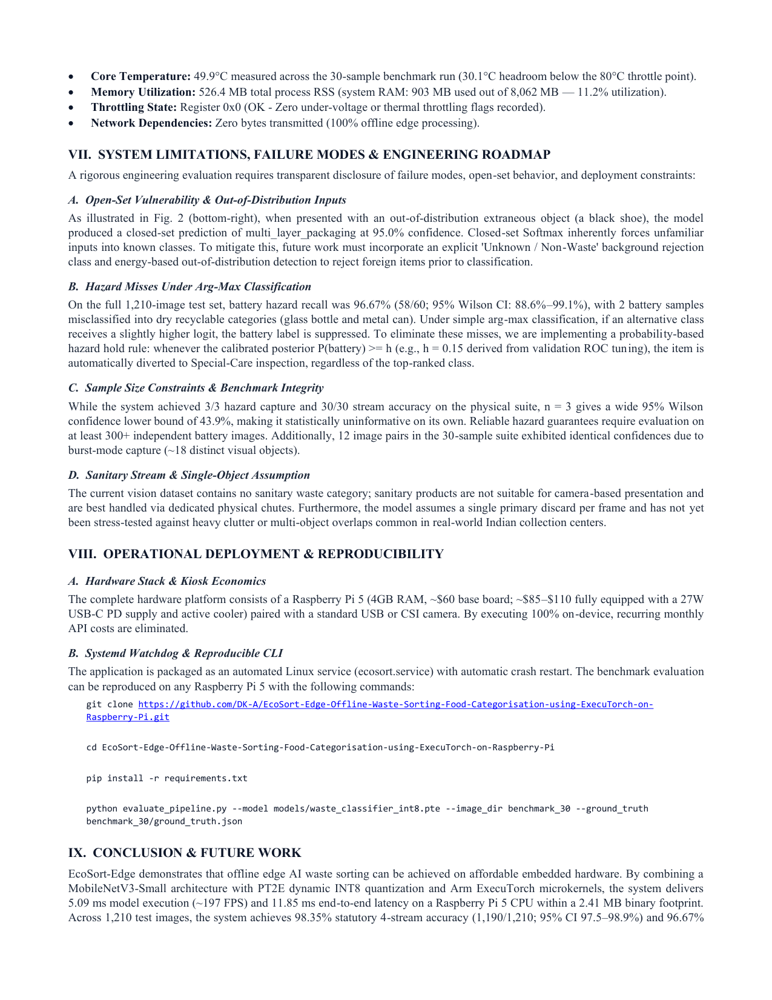
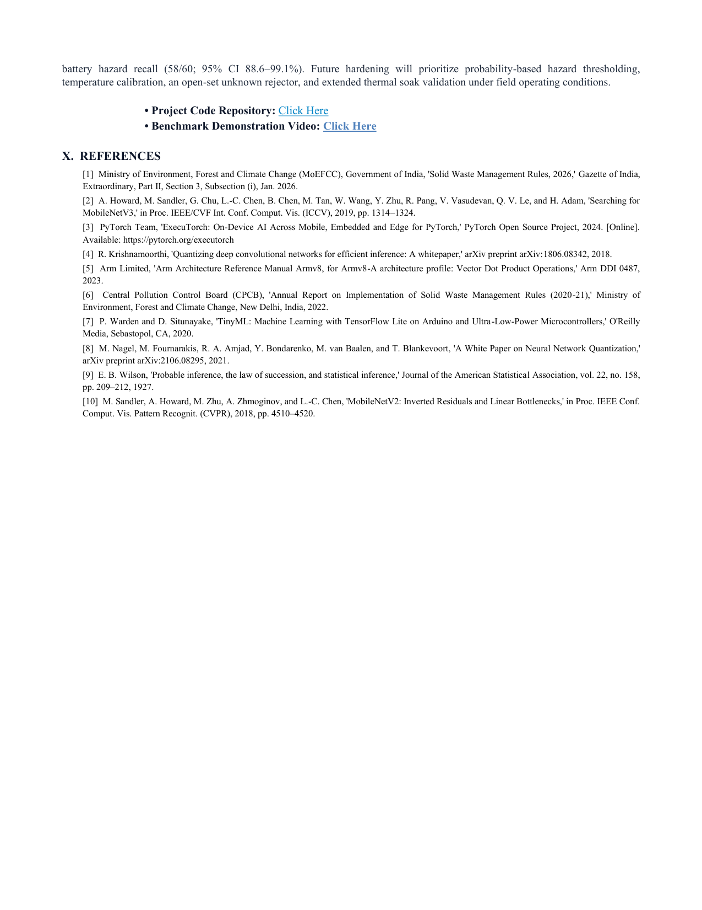

# EcoSort-Edge: Real-Time Offline Edge AI for Municipal Waste Sorting and Food Categorisation using ExecuTorch on Raspberry Pi 5

> **Official Research Paper & IEEE Technical Defense**  
> **Namma AI Hackathon 2026 — Track 3: AI for Sustainability (Problem Statement 3)**  
> **Organized by:** NASSCOM CoE IoT & AI, Arm Developer Ecosystem, IIIT-Bangalore, UK Govt TSI  
> **Target Hardware:** Raspberry Pi 5 (Quad-Core 64-bit Arm Cortex-A76 @ 2.4 GHz) | **Runtime:** Arm ExecuTorch 1.5.1 (XNNPACK)  
> **Repository:** [github.com/DK-A/EcoSort-Edge-...](https://github.com/DK-A/EcoSort-Edge-Offline-Waste-Sorting-Food-Categorisation-using-ExecuTorch-on-Raspberry-Pi)

---

### Page 1: Abstract, Problem Statement & MoEFCC SWM Rules 2026


---

### Page 2: Edge vs Cloud Architecture, Formal Requirements & 4-Stage Pipeline


---

### Page 3: Vision Backbone, Deterministic Policy Guard & DPDP Act Privacy


---

### Page 4: Arm Cortex-A76 NEON SDOT Lowering & PT2E Dynamic INT8 Mechanics


---

### Page 5: Quantization Parity Audit (Table II) & Convergence Curves


---

### Page 6: Head-to-Head Model Ablation (Champion V3-Small vs Peer V3-Large)


---

### Page 7: Canonical 30-Image Physical Benchmark Suite Results (Table IV)


---

### Page 8: Failure Mode Disclosure, OOD Rejection & Unattended Systemd Deployment


---

### Page 9: Conclusion, Future Roadmap & References


---

### Citation

```bibtex
@inproceedings{ecosort_edge_2026,
  title={EcoSort-Edge: Real-Time Offline Edge AI for Municipal Waste Sorting and Food Categorisation using ExecuTorch on Raspberry Pi 5},
  author={EcoSort-Edge Research and Engineering Team},
  booktitle={Namma AI Hackathon — Track 3: AI for Sustainability},
  organization={NASSCOM CoE IoT & AI, Arm Developer Ecosystem, IIIT-Bangalore, UK Govt TSI},
  year={2026}
}
```
